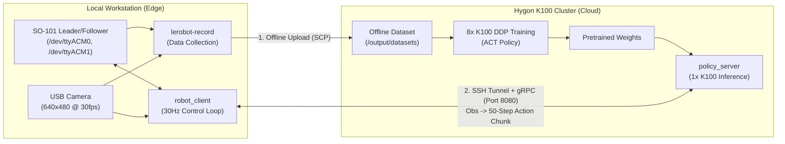

# lerobot-dcu

[](LICENSE)
[](https://github.com/huggingface/lerobot)
[](#verified-environment)
[](#verified-environment)

**End-to-End Cloud-Edge Embodied AI Pipeline for Hygon DCU (海光 K100) and Physical SO-101 Robotic Arms.**

`lerobot-dcu` provides a production-ready adaptation of [Hugging Face LeRobot](https://github.com/huggingface/lerobot) (`v0.4.4`) on domestic **Hygon K100 DCU** clusters (e.g., OpenBayes), bridging local physical hardware with cloud-side distributed training and real-time asynchronous inference.

---

## Architecture

Because cloud compute containers cannot directly mount local USB serial buses or webcams, `lerobot-dcu` adopts a decoupled **Local Hardware + Cloud Brain** architecture. Real-time control runs over an encrypted **SSH tunnel + gRPC (`async_inference`)**, using **Action Chunking** and asynchronous prefetching to mask network latency.



---

## Verified Environment

| Component | Cloud Side (OpenBayes / Hygon DCU) | Local Side (Edge Workstation) |
| :--- | :--- | :--- |
| **Hardware** | 8 × Hygon K100_AI (DCU) | x86_64 Linux + SO-101 Arm + USB Webcam |
| **OS / Driver** | Linux + Hygon DTK 26.04 | Ubuntu 20.04 / 24.04 |
| **Python** | 3.10.13 (Isolated `.venv`) | 3.10 (`uv` managed `.venv`) |
| **Deep Learning** | PyTorch 2.7.1 (Hygon ROCm) | CPU / CUDA (Client-side lightweight) |
| **LeRobot** | `v0.4.4` (Editable source install) | `v0.4.4` |
| **NumPy ABI** | `1.25.0` (Pinned for Hygon PyTorch) | `1.26.4` (Pinned for gRPC 1.x compatibility) |
| **Video Backend** | `pyav` (`libsvtav1`) | OpenCV (`640×480 @ 30fps`) |

---

## Key Features

- **Offline Hygon DCU Environment Isolation**: Preserves system-customized Hygon PyTorch & DTK 26.04 while isolating LeRobot dependencies via `.venv` and `PYTHONPATH` ordering.
- **Multi-DCU Distributed Training**: Ready-to-run 8× K100 DDP (`torch.distributed.run`) training scripts for ACT policies without requiring internet access inside containers.
- **Low-Latency Cloud-Edge Control**: Decoupled gRPC `policy_server` and `robot_client` over SSH port forwarding with 50-step Action Chunking, `0.5` prefetch threshold, and `weighted_average` trajectory smoothing.
- **Out-of-the-Box Bug Workarounds**: Resolves LeRobot `v0.4.4` `robot_client` hardware auto-registration failure (`so101_follower`) and cross-platform NumPy 1.x/2.x pickle serialization mismatches.

---

## Repository Structure

```text
lerobot-dcu/
├── README.md
├── LICENSE
├── scripts/
│   ├── cloud/
│   │   ├── activate_dcu.sh      # Hygon K100 venv activation & PYTHONPATH isolation
│   │   ├── train_8dcu_ddp.sh    # 8-DCU DDP ACT training script
│   │   └── launch_server.sh     # Single-DCU gRPC policy_server launcher
│   └── local/
│       ├── record_so101.sh      # Local SO-101 dataset recording script
│       ├── start_tunnel.sh      # Parameterized SSH port forwarding script
│       └── launch_client.sh     # Local SO-101 robot_client launcher
└── docs/
    └── troubleshooting.md       # Detailed Hygon DCU & SO-101 debugging guide
```

---

## Quick Start

### 1. Local Setup & Data Collection

Ensure your local `.venv` pins `numpy==1.26.4` to match the cloud-side NumPy 1.x ABI:

```bash
uv pip install --no-deps "numpy==1.26.4"
```

Calibrate both leader (`/dev/ttyACM0`) and follower (`/dev/ttyACM1`) arms, then record demonstrations using an **absolute path** for `--dataset.root`:

```bash
lerobot-record \
    --robot.type=so101_follower \
    --robot.port=/dev/ttyACM1 \
    --robot.id=my_so101_follower \
    --robot.cameras="{ top: {type: opencv, index_or_path: 0, width: 640, height: 480, fps: 30} }" \
    --teleop.type=so101_leader \
    --teleop.port=/dev/ttyACM0 \
    --teleop.id=my_so101_leader \
    --dataset.repo_id=local/so101_demo \
    --dataset.root=/home/$USER/lerobot/data/so101_demo \
    --dataset.num_episodes=50 \
    --dataset.episode_time_s=20 \
    --dataset.reset_time_s=10 \
    --dataset.single_task="pick and place" \
    --dataset.push_to_hub=false
```

### 2. Upload Dataset to Cloud

Configure your cloud connection variables and transfer the dataset via `scp`:

```bash
export CLOUD_HOST="<your-openbayes-host>"
export CLOUD_PORT="<your-ssh-port>"

scp -P ${CLOUD_PORT} -r /home/$USER/lerobot/data/so101_demo \
    root@${CLOUD_HOST}:/output/datasets/
```

### 3. Train ACT Policy on 8× Hygon K100

Inside the OpenBayes container, activate the isolated DCU environment and launch 8-DCU DDP training:

```bash
source scripts/cloud/activate_dcu.sh

RUN_NAME="act_so101_$(date +%Y%m%d_%H%M%S)"

CUDA_VISIBLE_DEVICES=0,1,2,3,4,5,6,7 \
/output/lerobot-dcu/.venv/bin/python -m torch.distributed.run \
    --standalone --nnodes=1 --nproc-per-node=8 \
    -m lerobot.scripts.lerobot_train \
    --dataset.repo_id=local/so101_demo \
    --dataset.root=/output/datasets/so101_demo \
    --dataset.video_backend=pyav \
    --policy.type=act \
    --policy.device=cuda \
    --policy.push_to_hub=false \
    --output_dir=/output/lerobot-dcu/outputs/${RUN_NAME} \
    --job_name=${RUN_NAME} \
    --batch_size=8 \
    --steps=20000 \
    --num_workers=4 \
    --save_checkpoint=true \
    --save_freq=5000 \
    --wandb.enable=false
```

### 4. Real-Time Cloud-Edge Inference

**Terminal 1 (Cloud Container)** — Start the gRPC policy server on DCU 0:
```bash
CUDA_VISIBLE_DEVICES=0 \
/output/lerobot-dcu/.venv/bin/python -m lerobot.async_inference.policy_server \
    --host=127.0.0.1 --port=8080 --fps=30 \
    --inference_latency=0.033 --obs_queue_timeout=2
```

**Terminal 2 (Local Workstation)** — Establish the SSH tunnel:
```bash
ssh -N -L 8080:localhost:8080 root@${CLOUD_HOST} -p ${CLOUD_PORT}
```

**Terminal 3 (Local Workstation)** — Launch the SO-101 follower client (pre-importing `lerobot_record` ensures `so101_follower` is registered in `v0.4.4`):
```bash
python -c "import lerobot.scripts.lerobot_record, runpy; runpy.run_module('lerobot.async_inference.robot_client', run_name='__main__')" \
    --server_address=127.0.0.1:8080 \
    --robot.type=so101_follower \
    --robot.port=/dev/ttyACM1 \
    --robot.id=my_so101_follower \
    --robot.cameras="{ top: {type: opencv, index_or_path: 0, width: 640, height: 480, fps: 30} }" \
    --policy_type=act \
    --pretrained_name_or_path=/output/lerobot-dcu/outputs/<RUN_NAME>/checkpoints/last/pretrained_model \
    --policy_device=cuda \
    --actions_per_chunk=50 \
    --chunk_size_threshold=0.5 \
    --aggregate_fn_name=weighted_average \
    --fps=30
```

---

## Known Issues & Fixes

| Symptom | Root Cause | Fix |
| :--- | :--- | :--- |
| `No module named 'numpy._core'` on gRPC | Local NumPy 2.x vs. Cloud NumPy 1.25.0 pickle mismatch | Pin local NumPy to `1.26.4` |
| `invalid choice: 'so101_follower'` | `robot_client.py` does not auto-import `so_follower` in v0.4.4 | Pre-import `lerobot.scripts.lerobot_record` before `runpy` |
| `FileExistsError` / missing `meta` dir | `~` in `--dataset.root` is not expanded by `Path` | Always pass an absolute path to `--dataset.root` |

See [`docs/troubleshooting.md`](docs/troubleshooting.md) for full debugging details.

---

## Roadmap

- [x] **v0.1**: Hygon K100 offline environment isolation, 8-DCU DDP training, and SO-101 cloud-edge gRPC closed-loop verification.


---

## License

This project is licensed under the [Apache-2.0 License](LICENSE). Built upon [Hugging Face LeRobot](https://github.com/huggingface/lerobot).