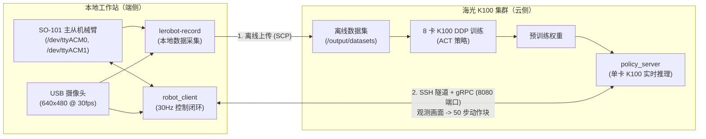

# lerobot-dcu

[](LICENSE)
[](https://github.com/huggingface/lerobot)
[](#已验证环境)
[](#已验证环境)

[English](README.md) | **简体中文**

**面向国产海光 DCU（K100）与实体 SO-101 机械臂的端云协同具身智能全链路框架。**

`lerobot-dcu` 提供了 [Hugging Face LeRobot](https://github.com/huggingface/lerobot)（`v0.4.4`）在国产**海光 K100 DCU** 集群（如 OpenBayes）上的生产级适配方案，打通了本地实体机械臂数据采集、云端多卡分布式训练与跨网实时异步推理控制的完整闭环。

---

## 系统架构

由于云端算力容器无法直接挂载本地物理 USB 串口与摄像头，`lerobot-dcu` 采用**“本地管硬件 + 云端管算力”**的解耦架构。实时控制通过加密 **SSH 隧道 + gRPC（`async_inference`）** 运行，结合**动作块预测（Action Chunking）**与异步预取机制掩盖网络延迟，实现丝滑的跨网实机控臂。



---

## 已验证环境

| 组件 | 云端（OpenBayes / 海光 DCU） | 本地（边缘工作站） |
| :--- | :--- | :--- |
| **硬件平台** | 8 × 海光 K100_AI（DCU） | x86_64 Linux + SO-101 主从臂 + USB 摄像头 |
| **系统 / 驱动** | Linux + 海光 DTK 26.04 | Ubuntu 20.04 / 24.04 |
| **Python** | 3.10.13（独立隔离 `.venv`） | 3.10（`uv` 管理的 `.venv`） |
| **深度学习框架** | PyTorch 2.7.1（海光 ROCm 定制版） | CPU / CUDA（客户端轻量运行） |
| **LeRobot** | `v0.4.4`（源码可编辑安装） | `v0.4.4` |
| **NumPy ABI** | `1.25.0`（锁定以兼容海光 PyTorch） | `1.26.4`（锁定以对齐 gRPC 1.x 序列化） |
| **视频后端** | `pyav`（`libsvtav1`） | OpenCV（`640×480 @ 30fps`） |

---

## 核心特性

- **海光 DCU 离线环境隔离**：在完整保留系统定制海光 PyTorch 与 DTK 26.04 的前提下，通过独立 `.venv` 与 `PYTHONPATH` 优先级重排隔离 LeRobot 依赖，支持无外网容器稳定运行。
- **多卡 DCU 分布式训练**：内置开箱即用的 8 卡海光 K100 DDP（`torch.distributed.run`）ACT 策略训练脚本，全程无需访问外部 Hub。
- **低延迟端云闭环控制**：基于 SSH 端口转发与 gRPC 异步推理（单次预测 50 步动作块、`0.5` 提前预取阈值、`weighted_average` 加权轨迹融合），有效消除跨网控制卡顿。
- **内置上游缺陷规避**：开箱解决 LeRobot `v0.4.4` 中 `robot_client` 未自动注册 `so101_follower` 硬件类，以及跨端 NumPy 1.x/2.x pickle 反序列化冲突问题。

---

## 目录结构

```text
lerobot-dcu/
├── README.md
├── README_ZH.md
├── LICENSE
├── scripts/
│   ├── cloud/
│   │   ├── activate_dcu.sh      # 海光 K100 虚拟环境激活与 PYTHONPATH 隔离
│   │   ├── train_8dcu_ddp.sh    # 8 卡海光 K100 DDP 分布式训练脚本
│   │   └── launch_server.sh     # 单卡 DCU gRPC 推理服务端启动脚本
│   └── local/
│       ├── record_so101.sh      # 本地 SO-101 实体臂数据采集脚本
│       ├── start_tunnel.sh      # 参数化 SSH 端口转发隧道脚本
│       └── launch_client.sh     # 本地 SO-101 实体从臂客户端启动脚本
└── docs/
    └── troubleshooting.md       # 海光 DCU 与 SO-101 端云联调避坑指南
```

---

## 快速上手

### 1. 本地环境准备与数据采集

首先将本地 `.venv` 中的 NumPy 锁定为 `1.26.4`，以匹配云端海光环境的 NumPy 1.x 序列化协议：

```bash
uv pip install --no-deps "numpy==1.26.4"
```

完成主臂（`/dev/ttyACM0`）与从臂（`/dev/ttyACM1`）校准后，使用**绝对路径**指定 `--dataset.root` 开始录制示教数据：

```bash
lerobot-record \
    --robot.type=so101_follower \
    --robot.port=/dev/ttyACM1 \
    --robot.id=my_so101_follower \
    --robot.cameras="{ top: {type: opencv, index_or_path: 0, width: 640, height: 480, fps: 30} }" \
    --teleop.type=so101_leader \
    --teleop.port=/dev/ttyACM0 \
    --teleop.id=my_so101_leader \
    --dataset.repo_id=local/so101_demo \
    --dataset.root=/home/$USER/lerobot/data/so101_demo \
    --dataset.num_episodes=50 \
    --dataset.episode_time_s=20 \
    --dataset.reset_time_s=10 \
    --dataset.single_task="pick and place" \
    --dataset.push_to_hub=false
```

### 2. 上传数据集至云端

配置云端服务器连接变量，通过 `scp` 上传离线数据集：

```bash
export CLOUD_HOST="<你的OpenBayes域名或IP>"
export CLOUD_PORT="<你的SSH端口>"

scp -P ${CLOUD_PORT} -r /home/$USER/lerobot/data/so101_demo \
    root@${CLOUD_HOST}:/output/datasets/
```

### 3. 在 8 卡海光 K100 上训练 ACT 策略

在 OpenBayes 容器内激活隔离环境并启动 8 卡 DDP 分布式训练：

```bash
source scripts/cloud/activate_dcu.sh

RUN_NAME="act_so101_$(date +%Y%m%d_%H%M%S)"

CUDA_VISIBLE_DEVICES=0,1,2,3,4,5,6,7 \
/output/lerobot-dcu/.venv/bin/python -m torch.distributed.run \
    --standalone --nnodes=1 --nproc-per-node=8 \
    -m lerobot.scripts.lerobot_train \
    --dataset.repo_id=local/so101_demo \
    --dataset.root=/output/datasets/so101_demo \
    --dataset.video_backend=pyav \
    --policy.type=act \
    --policy.device=cuda \
    --policy.push_to_hub=false \
    --output_dir=/output/lerobot-dcu/outputs/${RUN_NAME} \
    --job_name=${RUN_NAME} \
    --batch_size=8 \
    --steps=20000 \
    --num_workers=4 \
    --save_checkpoint=true \
    --save_freq=5000 \
    --wandb.enable=false
```

### 4. 端云实时推理与实体臂控制

**终端 1（云端容器）** — 在 0 号海光卡上启动 gRPC 推理服务：
```bash
CUDA_VISIBLE_DEVICES=0 \
/output/lerobot-dcu/.venv/bin/python -m lerobot.async_inference.policy_server \
    --host=127.0.0.1 --port=8080 --fps=30 \
    --inference_latency=0.033 --obs_queue_timeout=2
```

**终端 2（本地工作站）** — 建立并保持 SSH 端口转发隧道：
```bash
ssh -N -L 8080:localhost:8080 root@${CLOUD_HOST} -p ${CLOUD_PORT}
```

**终端 3（本地工作站）** — 启动 SO-101 实体从臂客户端（通过预导入 `lerobot_record` 自动完成 `v0.4.4` 硬件类注册）：
```bash
python -c "import lerobot.scripts.lerobot_record, runpy; runpy.run_module('lerobot.async_inference.robot_client', run_name='__main__')" \
    --server_address=127.0.0.1:8080 \
    --robot.type=so101_follower \
    --robot.port=/dev/ttyACM1 \
    --robot.id=my_so101_follower \
    --robot.cameras="{ top: {type: opencv, index_or_path: 0, width: 640, height: 480, fps: 30} }" \
    --policy_type=act \
    --pretrained_name_or_path=/output/lerobot-dcu/outputs/<RUN_NAME>/checkpoints/last/pretrained_model \
    --policy_device=cuda \
    --actions_per_chunk=50 \
    --chunk_size_threshold=0.5 \
    --aggregate_fn_name=weighted_average \
    --fps=30
```

---

## 常见问题与修复

| 报错现象 | 根本原因 | 解决方案 |
| :--- | :--- | :--- |
| gRPC 报错 `No module named 'numpy._core'` | 本地 NumPy 2.x 与云端 NumPy 1.25.0 的 pickle 序列化不兼容 | 将本地 NumPy 锁定降级至 `1.26.4` |
| `invalid choice: 'so101_follower'` | LeRobot `v0.4.4` 的 `robot_client.py` 未自动导入 `so_follower` 模块 | 启动前通过 `python -c` 预导入 `lerobot.scripts.lerobot_record` |
| `FileExistsError` 或缺少 `meta` 目录 | `--dataset.root` 中的 `~` 未被 `Path` 展开 | 始终向 `--dataset.root` 传入完整绝对路径 |

完整排查步骤请参阅 [`docs/troubleshooting.md`](docs/troubleshooting.md)。

---

## 开发路线图

- [x] **v0.1**：海光 K100 离线环境隔离、8 卡 DDP 分布式训练，以及 SO-101 端云 gRPC 闭环联调验证。
- [ ] **v0.2**：补充真机抓取放置实测 GIF、8 卡训练加速比与端到端 RPC 延迟压测报告（P50/P95/P99）。
- [ ] **v0.3**：合入 `lerobot_ros2_bridge` 功能包（ROS 2 节点封装、断网急停看门狗、速度限幅与 RViz 轨迹可视化）。

---

## 开源协议

本项目基于 [Apache-2.0 License](LICENSE) 开源，核心框架构建于 [Hugging Face LeRobot](https://github.com/huggingface/lerobot)。